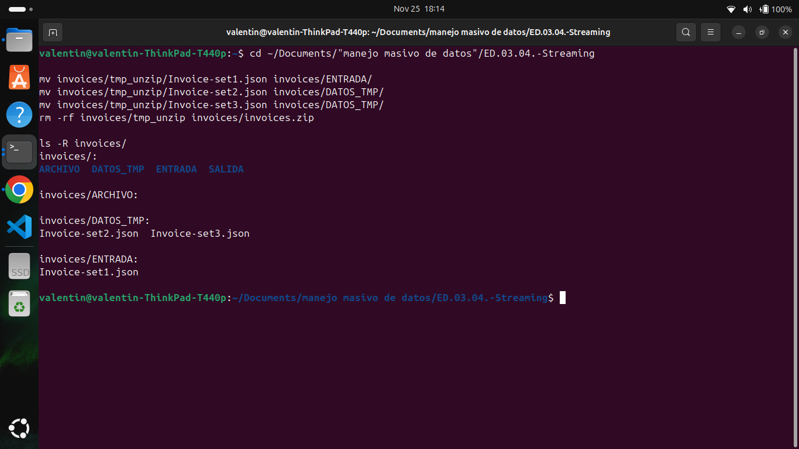
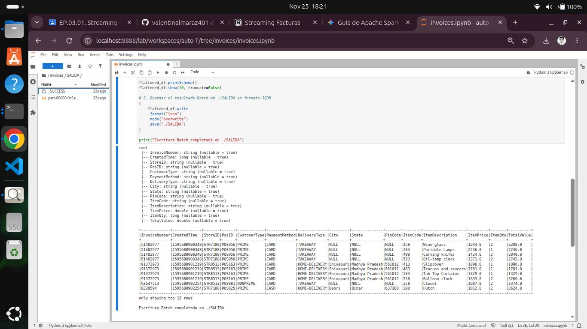
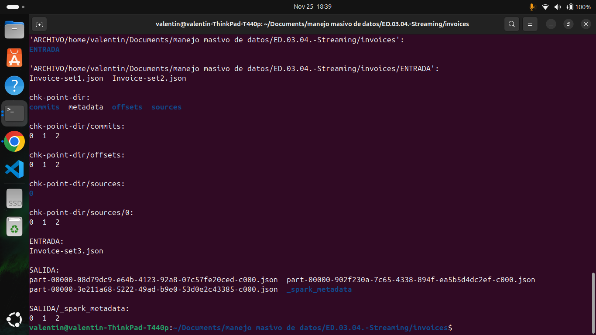
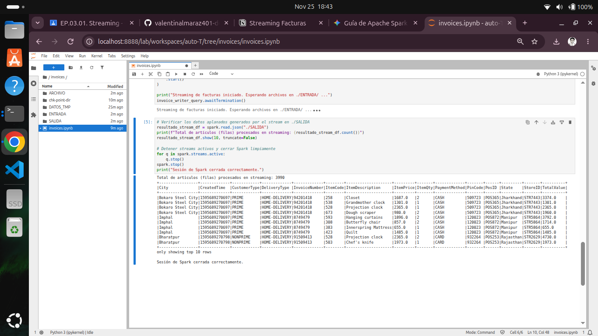

# EP.03.01 & EP.03.02 — Apache Spark Structured Streaming

Prácticas completas de procesamiento en tiempo real con **Apache Spark 3.5.3 (PySpark Structured Streaming)** ejecutadas sobre **Ubuntu Linux** y **JupyterLab**.

---

## 📁 Estructura del Proyecto

```text
ED.03.04.-Streaming/
├── Streaming1.ipynb                              # Parte 1: WordCount en tiempo real por Sockets y Triggers
├── Streaming1.pdf                                # Exportación PDF de la Parte 1
├── emisor.py                                     # Script emisor de líneas por socket TCP (puerto 9999)
├── invoices/
│   ├── invoices.ipynb                            # Parte 2: Procesamiento Batch y Streaming de Facturas JSON
│   ├── ENTRADA/                                  # Directorio monitoreado por readStream
│   ├── DATOS_TMP/                                # Lotes de facturas (Invoice-set2.json, Invoice-set3.json)
│   ├── SALIDA/                                   # Registros JSON aplanados resultantes del stream
│   ├── ARCHIVO/                                  # Facturas archivadas tras procesarse (cleanSource="archive")
│   └── chk-point-dir/                            # Directorio de checkpoints (offsets, commits, sources, metadata)
├── invoices.pdf                                  # Exportación PDF de la Parte 2
├── EP.03.01_y_EP.03.02_Streaming_Spark.pdf       # Documento PDF único unificado para entrega
├── capturas/                                     # Evidencia gráfica paso a paso (01 a 10)
└── README.md                                     # Documentación general del repositorio
```

---

## 🚀 Parte 1: Streaming con Sockets y Triggers (`Streaming1.ipynb`)

1. **Lectura desde Socket TCP (`localhost:9999`):** Ingesta de flujo continuo de texto mediante `spark.readStream.format("socket")` y emisión de frases desde terminal con `nc -lk 9999` y `emisor.py`.
2. **Conteo de Palabras en Tiempo Real (`WordCount`):** Transformación mediante `explode(split(value, " "))` y agrupación `groupBy("palabra").count()` con salida en consola (`outputMode("complete")`).
3. **Gestión de Triggers:**
   * **Micro-lotes por defecto (`ProcessingTime(0)`):** Procesamiento inmediato conforme llegan datos.
   * **Intervalo fijo (`trigger(processingTime="1 minute")`):** Acumulación de eventos durante 60 segundos antes de disparar cada micro-lote.

---

## 🧾 Parte 2: Streaming Facturas con Ficheros (`invoices/invoices.ipynb`)

1. **Versión Inicial (Batch):** Lectura de facturas anidadas desde `ENTRADA/*.json`, descomposición del arreglo `InvoiceLineItems` mediante `explode()` y aplanado de campos (`DeliveryAddress`, `LineItem`) hacia `SALIDA/`.
2. **Versión Structured Streaming:**
   * **Control de flujo (`maxFilesPerTrigger=1`):** Procesamiento secuencial de 1 archivo JSON por micro-lote.
   * **Archivado automático (`cleanSource="archive"`):** Traslado de cada factura procesada hacia `./ARCHIVO`.
   * **Tolerancia a fallos (`checkpointLocation="./chk-point-dir"`):** Persistencia de `offsets/`, `commits/`, `sources/` y `metadata/` garantizando procesamiento *exactly-once* ante fallos o reinicios (3,990 artículos procesados en total).

---

## 📸 Evidencia Visual

### Parte 1: Streaming por Sockets y Triggers
| Paso | Descripción | Captura |
| :--- | :--- | :--- |
| **01** | Entorno virtual y JupyterLab activos en Ubuntu |  |
| **02** | Creación de sesión Spark y lectura desde socket TCP |  |
| **03** | Emisión de palabras con Netcat (`nc -lk 9999`) |  |
| **04** | Conteo en tiempo real (Batch 0, 1 y 2) |  |
| **05** | Automatización de envío mediante `emisor.py` |  |
| **06** | Ejecución controlada por `trigger(processingTime="1 minute")` |  |

### Parte 2: Streaming Facturas (Batch, File Source y Checkpoints)
| Paso | Descripción | Captura |
| :--- | :--- | :--- |
| **07** | Organización de directorios (`ENTRADA`, `DATOS_TMP`, `SALIDA`, `ARCHIVO`) |  |
| **08** | Ejecución en modo Batch y escritura aplanada en `SALIDA/` |  |
| **09** | Verificación de `chk-point-dir/` (`offsets`, `commits`), `ARCHIVO/` y `SALIDA/` |  |
| **10** | Conteo total (3,990 registros) y cierre limpio de Spark |  |

---

## 🛠️ Requisitos y Ejecución

```bash
# Activar entorno virtual
source ../spark-practicas/venv/bin/activate

# Iniciar JupyterLab
jupyter lab
```